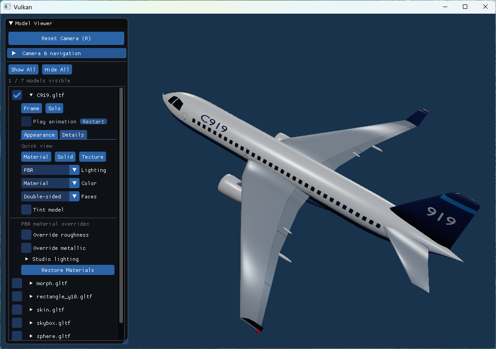
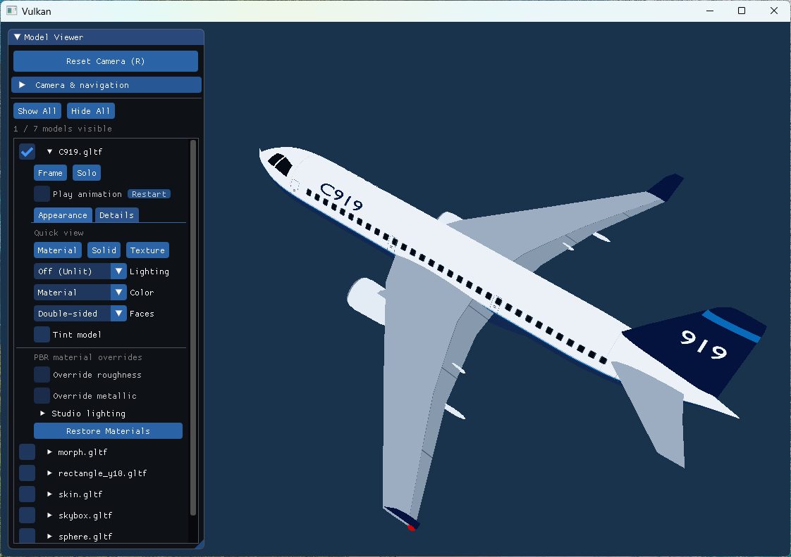
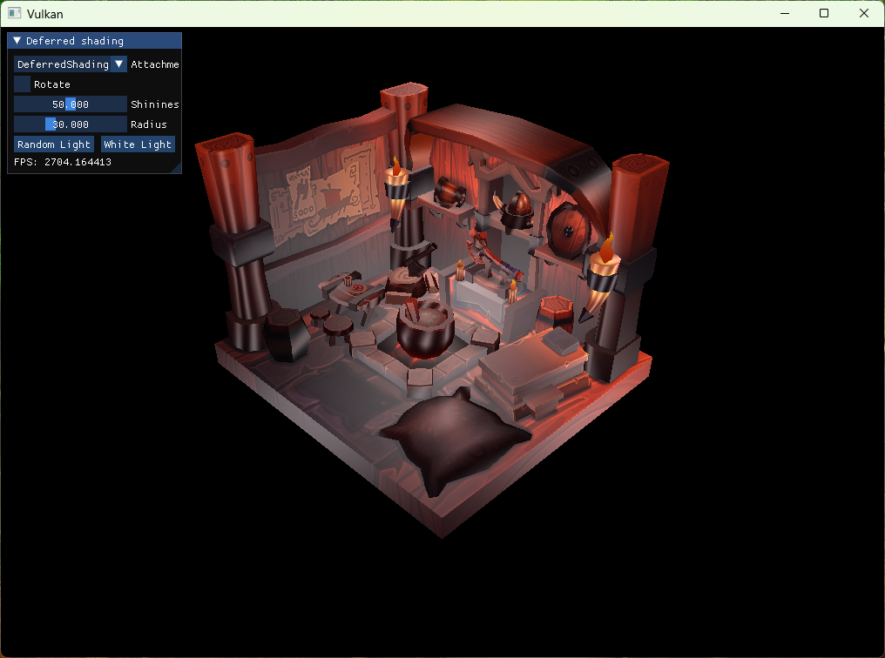
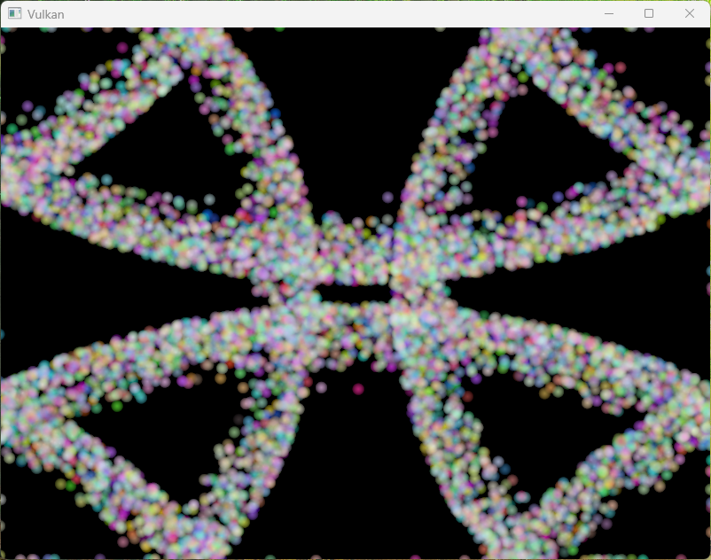
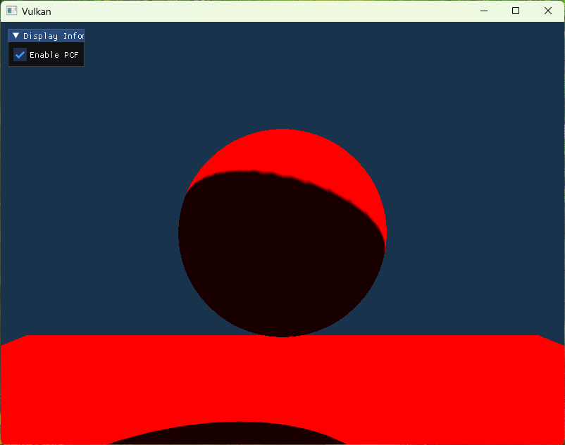
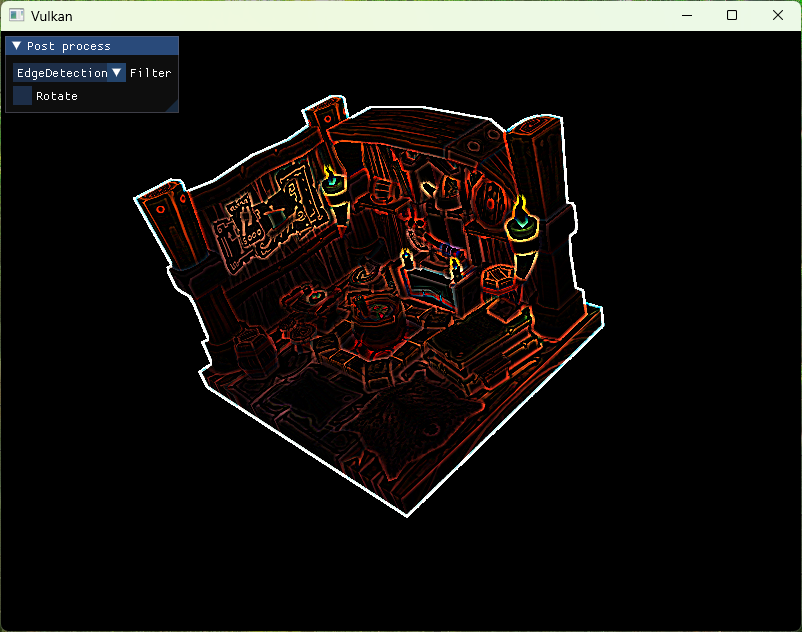
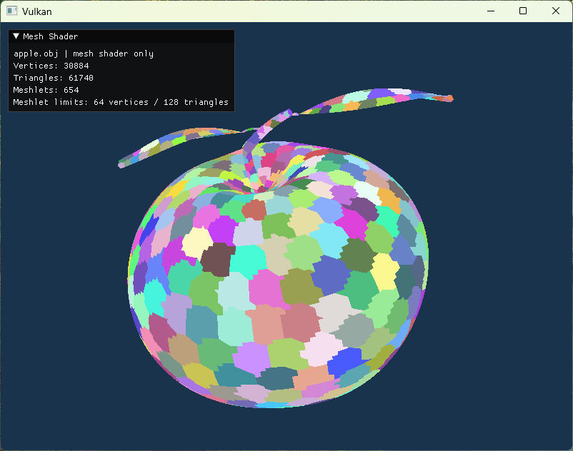
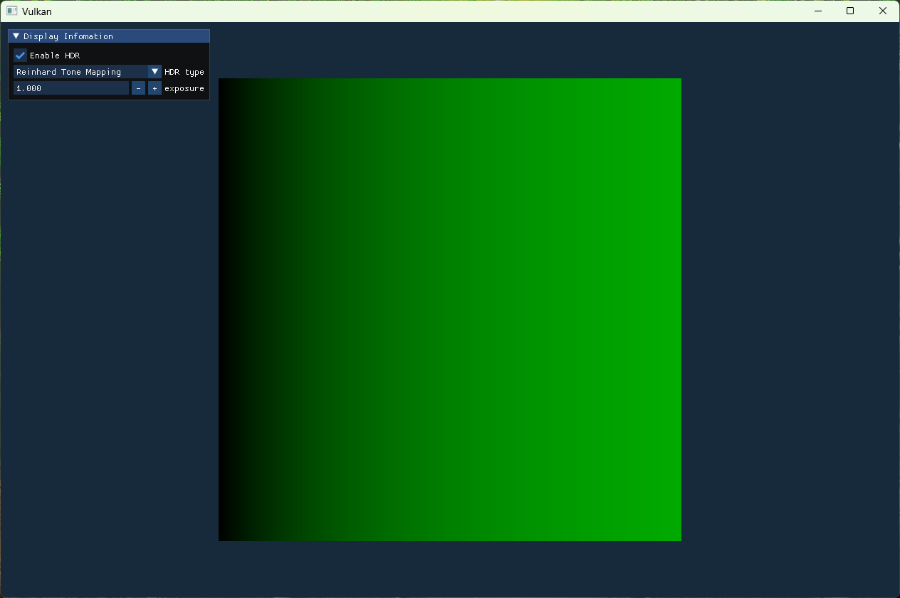

# vulkan-labs

基于 **C++20 与 Vulkan** 的图形和计算实验项目，包含独立技术示例与可复用渲染框架。

[效果展示](docs/gallery.md) · [构建与运行](docs/getting-started.md) · [示例目录](docs/samples.md) · [渲染框架](framework/README.md) · [文档](docs/README.md)

## 代码入口

| 目录 | 职责 | 阅读入口 |
| --- | --- | --- |
| `samples/` | 按主题组织的独立程序，各自管理设备、资源、命令和同步 | [示例目录](docs/samples.md) |
| `framework/` | Vulkan 1.3 运行时、资源封装、帧调度与 ImGui 集成，导出 `Framework::Framework` | [框架说明](framework/README.md) |

`samples/` 与 `framework/` 共享公共构建配置和第三方依赖；`samples/` 不链接框架。
独立示例的 `main.cpp`、`mainN.cpp` 对应不同可执行 target，便于连贯阅读各自的实现与 GLSL。

## 画面预览

| glTF：PBR 材质预览 | glTF：Unlit |
| --- | --- |
| [](docs/gallery.md#gltf-模型查看器) | [](docs/gallery.md#gltf-模型查看器) |
| 模型级颜色、金属度与粗糙度控制 | 关闭光照，直接查看材质颜色与纹理 |

| 延迟渲染 | GPU 粒子 |
| --- | --- |
| [](docs/gallery.md#延迟渲染) | [](docs/screenshots/01_09_compute_shader.mp4) |
| G-buffer、Subpass Input 与多光源着色 | 计算更新粒子，图形阶段读取同一缓冲绘制；点击预览观看视频 |

| 阴影映射 | 后处理 |
| --- | --- |
| [](docs/gallery.md#阴影映射) | [](docs/gallery.md#后处理) |
| 光源深度贴图、深度比较与 3×3 PCF | 离屏颜色采样、卷积滤镜与 FXAA |

| Mesh Shader | HDR 与色调映射 |
| --- | --- |
| [](docs/gallery.md#mesh-shader) | [](docs/gallery.md#hdr-与色调映射) |
| CPU 划分 meshlet，Mesh Shader 直接输出顶点与三角形 | 浮点离屏颜色与显示输出映射 |

更多附件视图、滤镜对比与 Cubemap 画面见[效果展示](docs/gallery.md)。

## 技术主题

- **资源与绑定**：顶点与索引、Uniform、动态偏移、Push Constants、纹理、Mipmap、OBJ / glTF。
- **内存分配**：VMA 分配器、Buffer / Image 分配与绑定、staging 上传和持久映射 Uniform。
- **渲染与图像**：PBR 材质、深度与模板、MSAA、离屏渲染、Input Attachments、延迟渲染、阴影与色调映射。
- **计算与命令**：粒子模拟、Storage Image、间接绘制参数、命令复用、多线程录制、查询与管线缓存。
- **API 与对象管理**：Geometry Shader、Mesh Shader、多视口、Multiview、Conditional Rendering、Dynamic Rendering、无窗口执行与 Vulkan-Hpp RAII。

## 构建与运行

Windows 和 Linux 均使用 CMake 3.25+、Ninja 与 Vulkan 开发工具。先在仓库根目录初始化资源子模块：

```sh
git submodule update --init --recursive
```

Windows 使用 MSVC x64，在已初始化 MSVC 环境的开发终端中执行：

```powershell
cmake --preset msvc-debug
cmake --build --preset msvc-debug --target 01_01_hello_triangle
.\build\msvc-debug\bin\01_01_hello_triangle.exe
```

Linux 使用 `linux-debug` 预设：

```bash
cmake --preset linux-debug
cmake --build --preset linux-debug --target 01_01_hello_triangle
./build/linux-debug/bin/01_01_hello_triangle
```

Shader 随 target 自动编译。两个平台均提供 Debug、Release 和启用 `clang-tidy` 的 Debug 预设。依赖、预设选择和 Visual Studio 入口见[构建与运行](docs/getting-started.md)。

## 技术文档

| 目的 | 入口 |
| --- | --- |
| 从画面找到实现 | [效果展示](docs/gallery.md) |
| 按主题选择可执行程序 | [示例目录](docs/samples.md) |
| 理解对象、坐标、资源与同步 | [Vulkan 基础](docs/vulkan-fundamentals.md) |
| 跟踪渲染和计算的数据流 | [专题实现](docs/rendering-techniques.md) |
| 了解模块与构建依赖 | [工程组织](docs/project-layout.md) |
| 修改代码和使用开发工具 | [开发指南](docs/development.md) |
| 使用框架接口与交互程序 | [渲染框架](framework/README.md) |

## 许可与参考

项目代码采用 [MIT License](LICENSE)。第三方源码与运行资源分别遵循其自身许可，见[第三方依赖](third_party/README.md)与[资源说明](assets/README.md)。

学习参考包括 [Vulkan Tutorial](https://vulkan-tutorial.com/)、[Sascha Willems Vulkan Examples](https://github.com/SaschaWillems/Vulkan) 和 [Khronos Vulkan Guide](https://docs.vulkan.org/guide/latest/)。具体 API 行为以 Vulkan 规范及设备能力为准。
