# 效果展示

[项目首页](../README.md) · [构建与运行](getting-started.md) · [全部示例](samples.md)

这里收录程序的运行画面。每个主题提供 target、源码和技术解析入口；使用 target 名称构建、启动的方法见运行指南。

## glTF 模型查看器

`01_06_loading_models2` 加载 glTF 模型，提供模型级颜色、光照与材质覆盖控制。下图使用同一 C919 模型，对比 PBR 与关闭光照后的显示。

| PBR | Off (Unlit) |
| --- | --- |
| 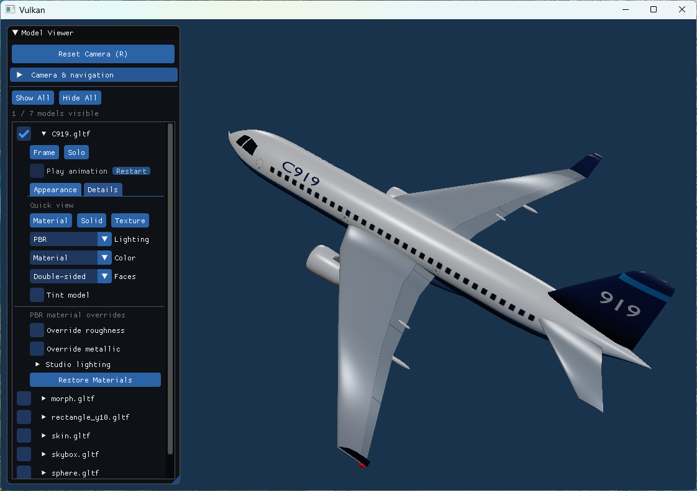 | 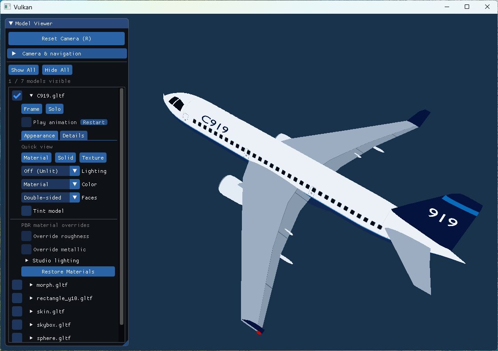 |

首次启动显示全部模型，并按可见模型的整体范围居中取景。默认使用双面显示和斜上方视角，便于观察 `morph.gltf`、`skin.gltf` 与 `rectangle_y10.gltf` 等薄片模型。

展开模型后，在 `Appearance` 页调整显示；节点、Primitive 与相机信息集中在 `Details` 页。

| 控件 | 作用 |
| --- | --- |
| Material / Solid / Texture | 快速切换原材质 PBR、Studio 单色与无光照纹理视图 |
| Lighting | `Off (Unlit)` 直接显示颜色；`Studio` 使用简化光照；`PBR` 使用金属度/粗糙度材质 |
| Color | `Material` 组合原材质因子、纹理与顶点色；`Texture` 查看基础色纹理；`Single` 使用模型统一颜色；`Vertex` 查看顶点色 |
| Faces | 默认 `Double-sided` 显示两面；`Material` 遵循原材质；`Single-sided` 丢弃背面 |
| Tint model | 为原材质、纹理或顶点色添加整体染色；选择 `Single` 时直接编辑统一颜色 |
| Override roughness / metallic | 分别启用模型级常量覆盖；关闭时恢复各材质的原始因子和贴图贡献 |
| Respect unlit materials | 在原材质 PBR 视图中保留显式声明为无光照的材质 |
| Studio lighting | 调整光照强度、曝光与近似环境项 |
| Restore Materials | 恢复原材质显示与默认查看设置 |

缺少纹理或顶点色时，相应颜色来源回退到材质颜色。PBR 使用 Studio 灯光与近似环境项，尚未接入 HDRI/IBL 和阴影。

| 操作 | 作用 |
| --- | --- |
| 左键拖动 / 右键拖动 / 滚轮 | 平移 / 绕观察中心旋转 / 缩放 |
| Reset Camera 或 `R` | 将当前可见模型整体居中取景；快捷键在视口接收键盘输入时生效 |
| Frame / Solo | 对该模型居中取景 / 只显示该模型并居中 |
| Show All / Hide All | 显示全部模型并重新取景 / 隐藏全部模型 |
| Play animation / Restart | 播放或暂停动画 / 从头播放；暂停状态下点击 Restart 回到动画起点 |

[主程序](../samples/01_vulkan_tutorial/06_loading_models/main2.cpp) · [统一顶点 Shader](../samples/01_vulkan_tutorial/06_loading_models/shaders/viewer.vert) · [材质 Shader](../samples/01_vulkan_tutorial/06_loading_models/shaders/viewer.frag) · [实现解析](rendering-techniques.md#gltf-材质预览与动画)

## 延迟渲染

`02_08_deferred_shading` 将颜色、法线和位置写入 G-buffer，再在后续 Subpass 读取附件，计算八个光源的贡献。界面可切换附件，并调整高光指数、光源衰减和光源颜色。

| 颜色附件（NoLight） | 法线附件 |
| --- | --- |
| 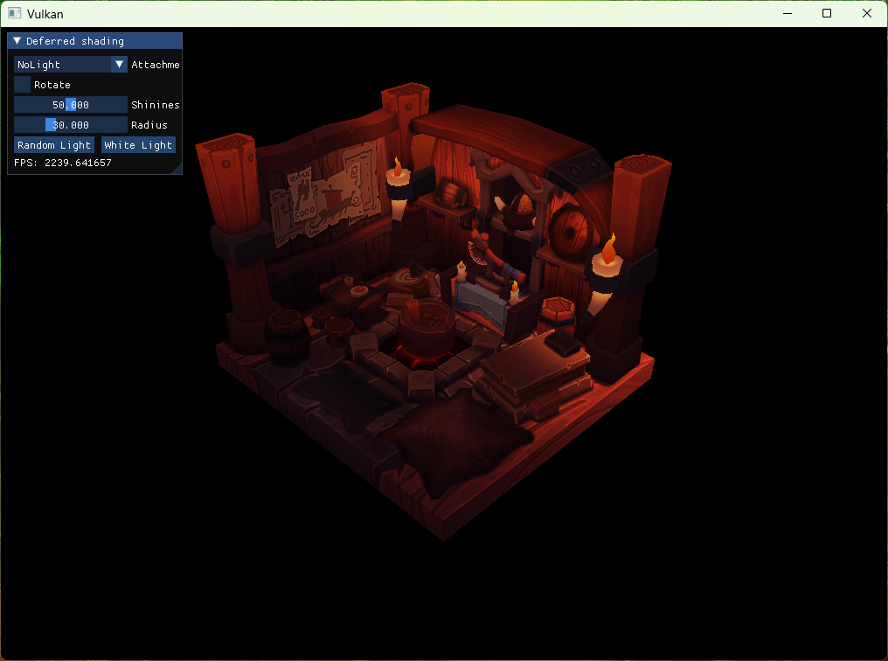 | 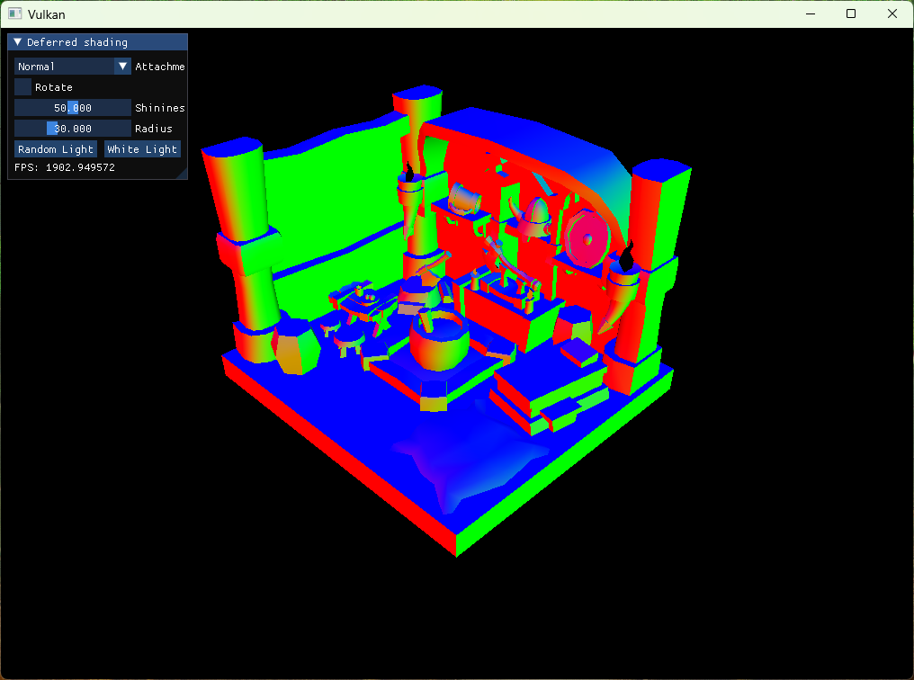 |
| **深度附件** | **光照合成** |
| 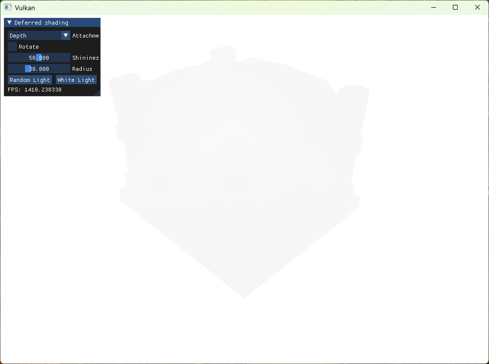 | 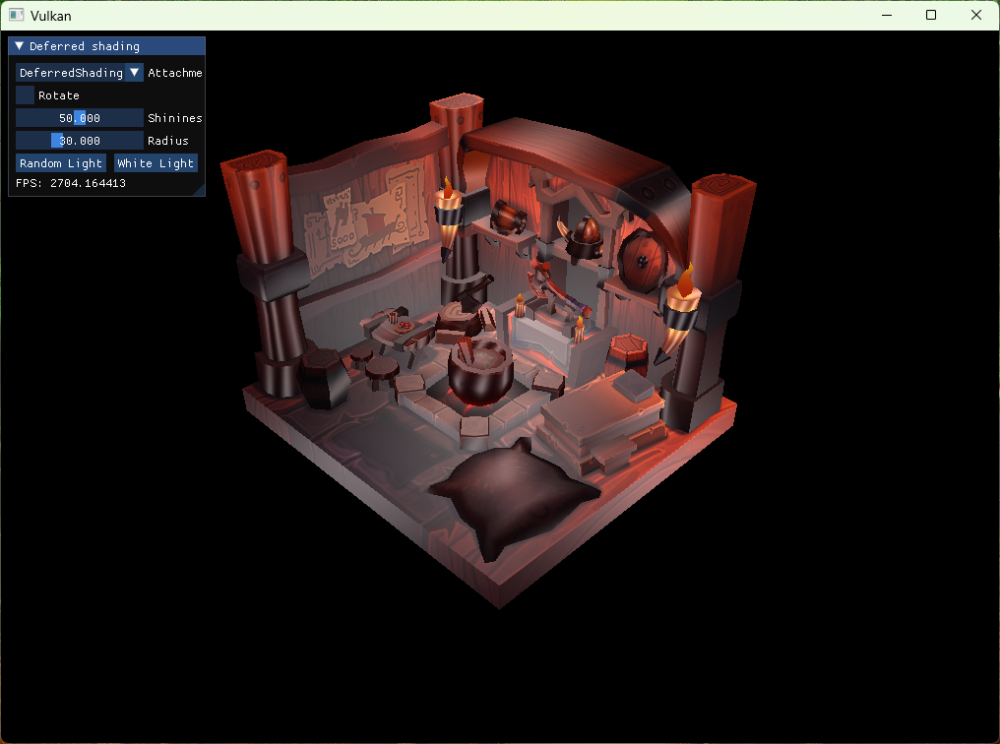 |

[主程序](../samples/02_advance/08_deferred_shading/main.cpp) · [G-buffer 输出](../samples/02_advance/08_deferred_shading/shaders/base.frag) · [光照 Shader](../samples/02_advance/08_deferred_shading/shaders/quad.frag) · [实现解析](rendering-techniques.md#附件与多阶段渲染)

## GPU 粒子

`01_09_compute_shader` 在计算着色器中更新 8192 个粒子的位置与速度，处理窗口边界反弹；输出缓冲同时作为图形阶段的顶点输入，绘制彩色点精灵。

[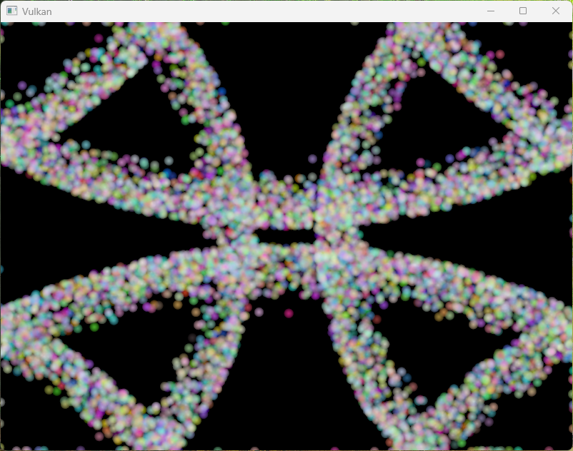](screenshots/01_09_compute_shader.mp4)

[观看粒子演示（MP4）](screenshots/01_09_compute_shader.mp4)

[主程序](../samples/01_vulkan_tutorial/09_compute_shader/main.cpp) · [计算 Shader](../samples/01_vulkan_tutorial/09_compute_shader/shaders/base.comp) · [粒子着色](../samples/01_vulkan_tutorial/09_compute_shader/shaders/base.frag) · [实现解析](rendering-techniques.md#计算与间接绘制)

## Mesh Shader

`06_04_mesh_shader` 使用 Mesh Shader 绘制苹果模型，表面的彩色分块对应不同 meshlet。

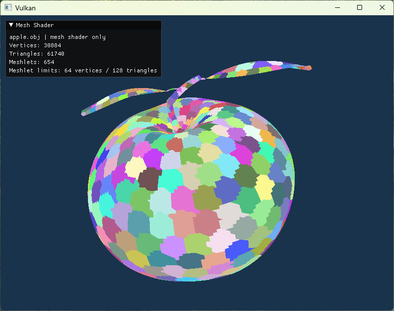

截图中的模型包含 30,884 个顶点、61,740 个三角形，划分为 654 个 meshlet。左上角界面显示模型数量统计与每个 meshlet 的顶点、三角形上限。

| 操作 | 作用 |
| --- | --- |
| 左键拖动 / 右键拖动 / 滚轮 | 平移 / 旋转视角 / 缩放 |
| `R` | 恢复默认视角 |

设备要求、模型资源与启动命令见[运行 Mesh Shader 示例](getting-started.md#运行-mesh-shader-示例)。

[主程序](../samples/06_extensions/04_mesh_shader/main.cpp) · [Mesh Shader](../samples/06_extensions/04_mesh_shader/shaders/base.mesh) · [片段着色](../samples/06_extensions/04_mesh_shader/shaders/base.frag) · [实现解析](rendering-techniques.md#mesh-shader-与-meshlet)

## 阴影映射

`08_01_shadow_mapping` 从光源视角生成 4096×4096 深度贴图，再从相机视角进行深度比较。场景由球体和平面组成，`Enable PCF` 切换单点比较与 3×3 邻域过滤。

| 单点深度比较 | 开启 PCF |
| --- | --- |
| 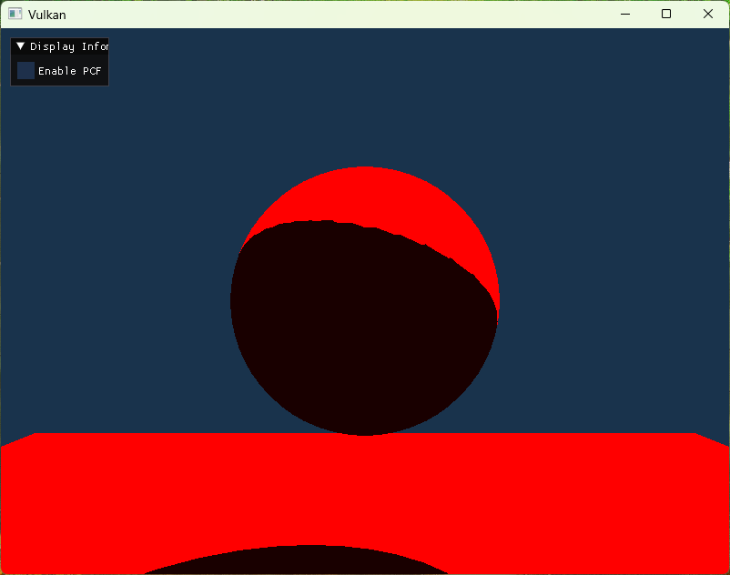 | 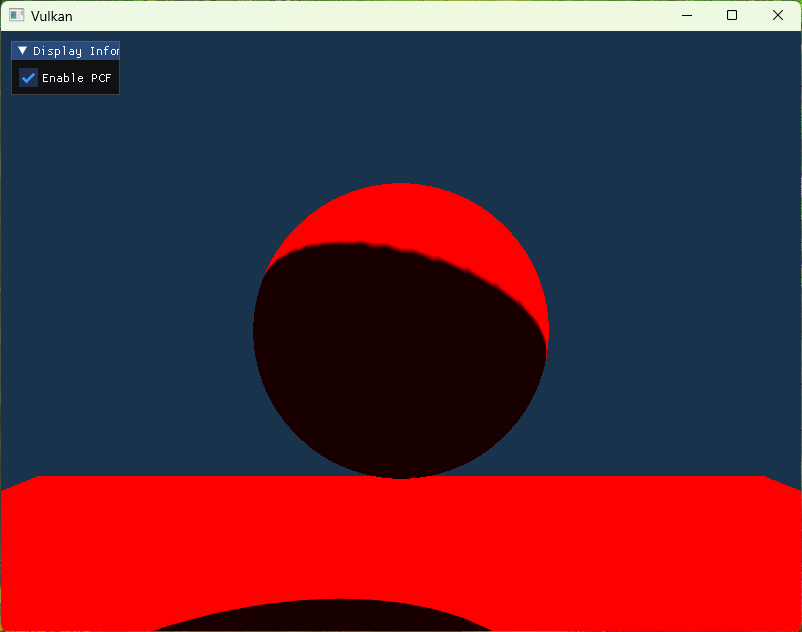 |

[主程序](../samples/08_showcases/01_shadow_mapping/main.cpp) · [阴影比较与 PCF](../samples/08_showcases/01_shadow_mapping/shaders/light.frag) · [实现解析](rendering-techniques.md#阴影与-hdr)

## 后处理

`02_10_post_process` 先绘制离屏场景，再通过全屏几何采样颜色附件。`Filter` 切换滤镜，`Rotate` 控制模型旋转。

| 原始输出 | 灰度 |
| --- | --- |
| 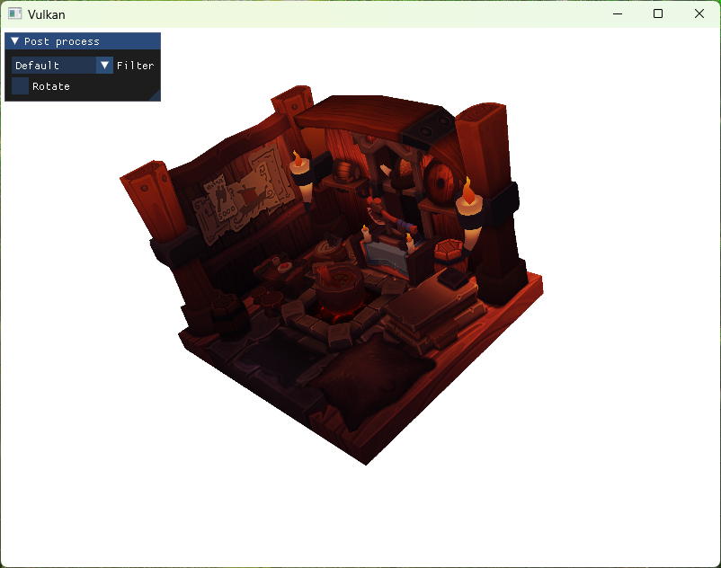 | 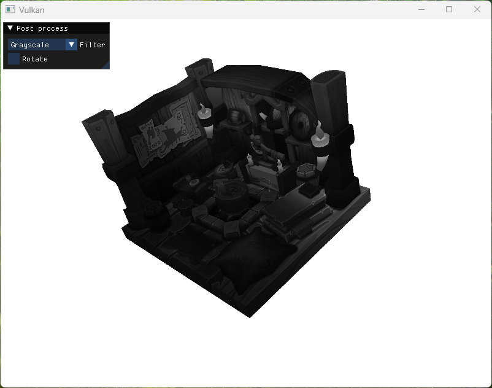 |
| **反相** | **锐化** |
| 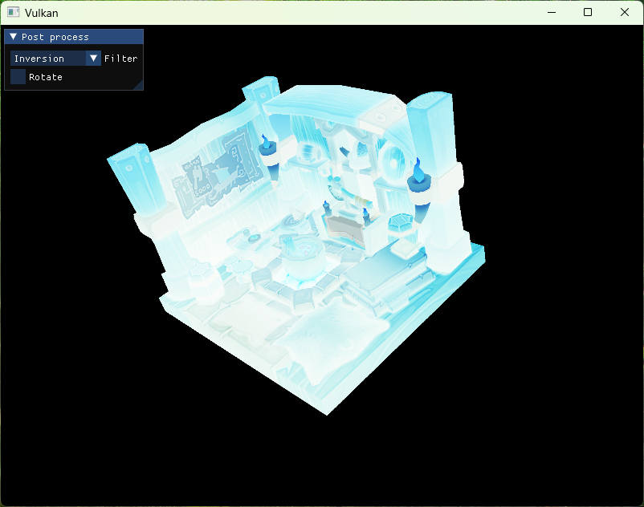 | 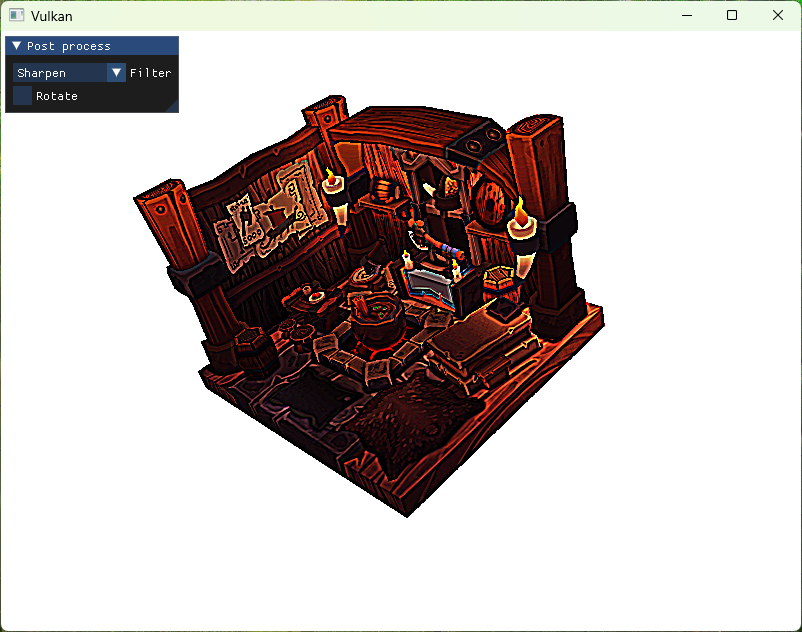 |
| **模糊** | **边缘检测** |
|  | 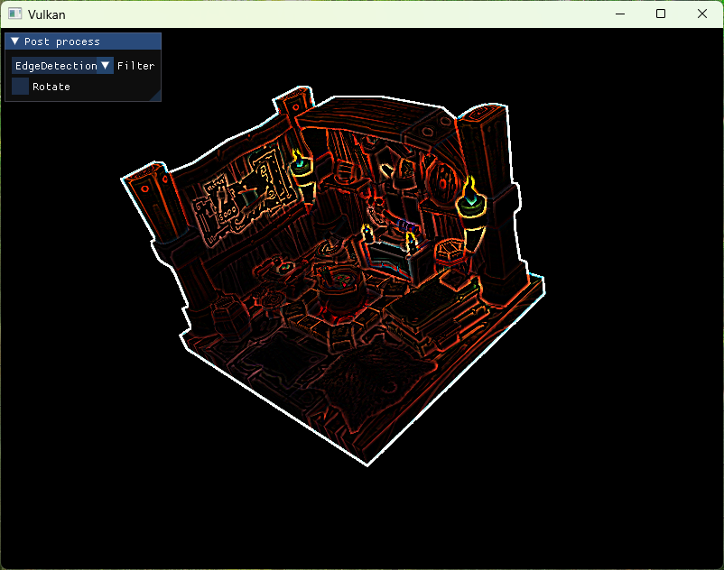 |

FXAA 输出

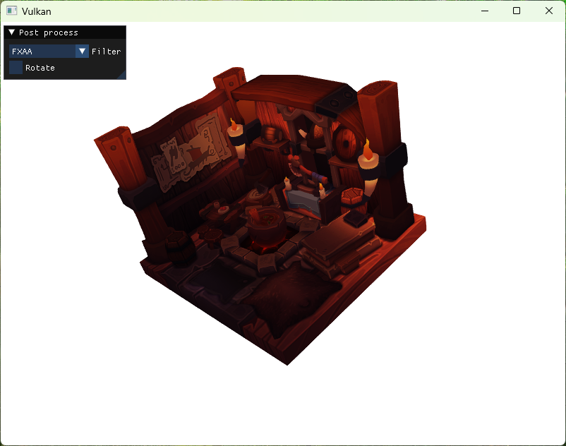

[主程序](../samples/02_advance/10_post_process/main.cpp) · [滤镜与 FXAA](../samples/02_advance/10_post_process/shaders/quad.frag) · [实现解析](rendering-techniques.md#附件与多阶段渲染)

## Cubemap

`02_23_texture_cube_map` 上传六面图像，创建 Cube Image View，并在立方体表面使用 `samplerCube` 按方向采样。

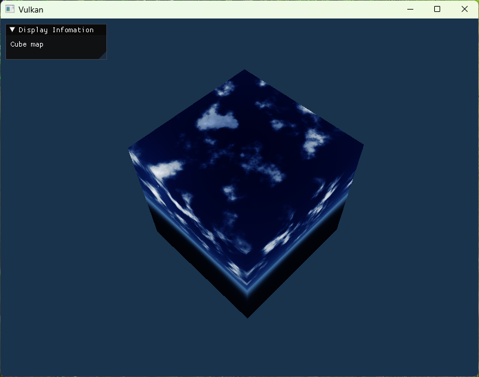

[主程序](../samples/02_advance/23_texture_cube_map/main.cpp) · [采样 Shader](../samples/02_advance/23_texture_cube_map/shaders/cube.frag) · [实现解析](rendering-techniques.md#资源与数据输入)

## HDR 与色调映射

`08_02_hdr` 使用浮点离屏附件保存高于 1 的颜色值，再映射到显示输出。高亮渐变几何用于比较直接输出、曝光和 Reinhard 映射。

| 关闭 HDR 映射 | 手动曝光：1.0 |
| --- | --- |
| 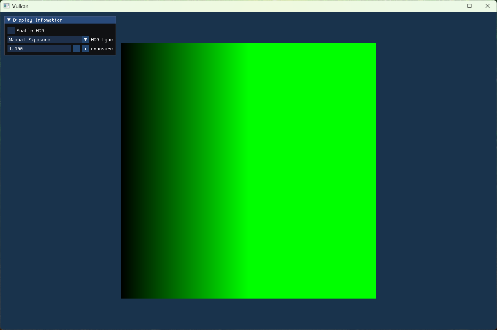 | 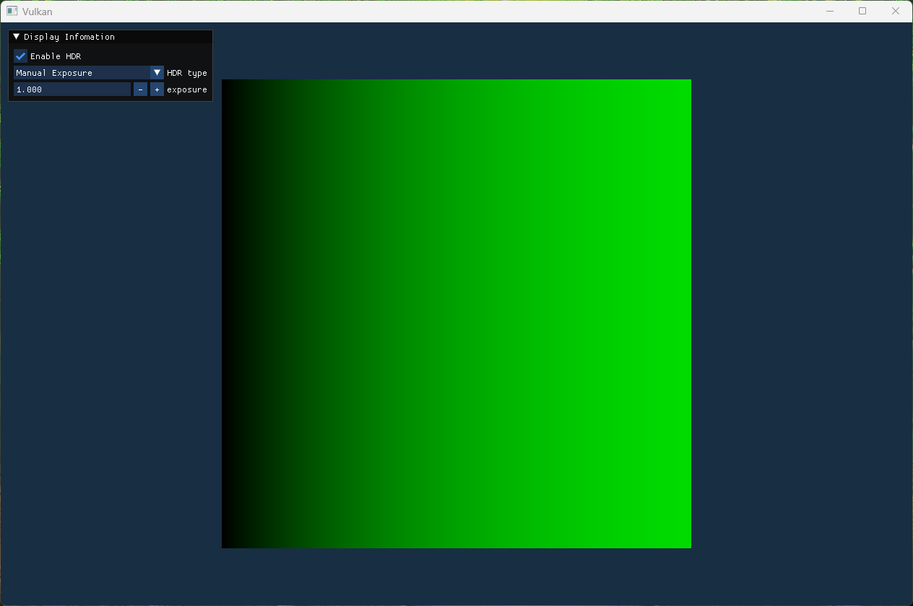 |
| **手动曝光：2.0** | **Reinhard** |
| 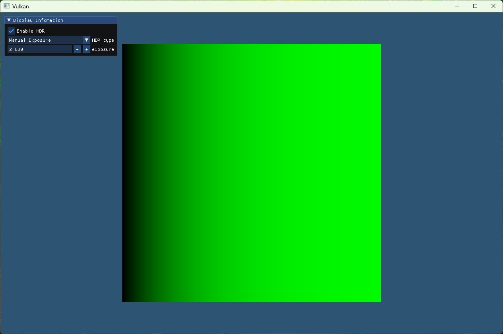 |  |

`Enable HDR` 控制是否映射，`HDR type` 选择算法；`exposure` 作用于手动曝光模式。

[主程序](../samples/08_showcases/02_hdr/main.cpp) · [色调映射 Shader](../samples/08_showcases/02_hdr/shaders/hdr2ldr.frag) · [实现解析](rendering-techniques.md#阴影与-hdr)

## 第一个三角形

`01_01_hello_triangle` 建立窗口、交换链和图形管线，将顶点颜色插值输出到屏幕。

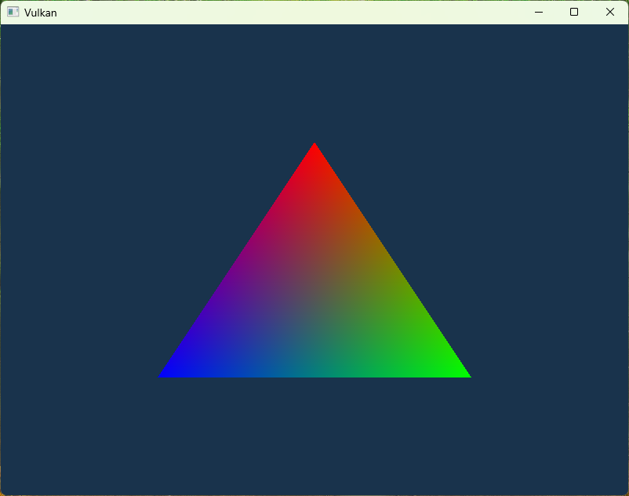

[主程序](../samples/01_vulkan_tutorial/01_hello_triangle/main.cpp) · [Vulkan 对象与生命周期](vulkan-fundamentals.md#对象与生命周期)
