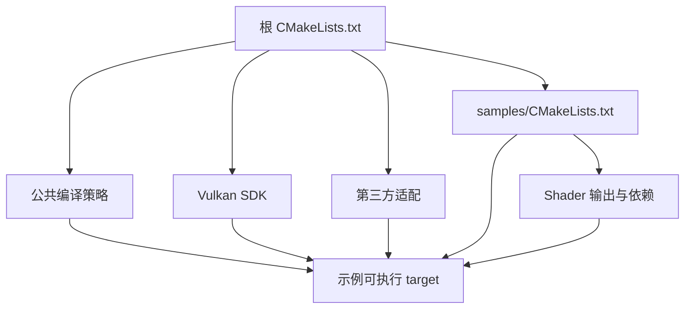

# 工程组织

[文档](README.md) · [开发指南](development.md) · [构建与运行](getting-started.md)

## 模块职责

`vulkan-labs` 通过公共 CMake 模块共享编译策略，通过独立可执行程序展示 Vulkan 的使用。每个示例直接组织自身的设备、资源、命令与同步；公共构建层负责依赖、工具和 Shader 产物。

```text
.
├── CMakeLists.txt          项目信息、语言标准、公共选项和子目录编排
├── CMakePresets.json       编译器、生成器和构建目录
├── cmake/                 公共编译配置与 Shader 编译函数
├── samples/               按主题分组的独立程序与 GLSL
├── third_party/           本地依赖源码、共享实现与 CMake 适配
├── assets/                模型、纹理等资源子模块
├── scripts/               Windows 构建和解决方案辅助脚本
├── hooks/                 提交检查工具
└── docs/                  使用、技术和开发文档及展示素材
```

示例名称及源码入口见[示例目录](samples.md)，运行环境与产物位置见[构建与运行](getting-started.md)。

## 构建依赖



根构建统一启用 C++20、关闭语言扩展，并提供 `BUILD_SAMPLES` 和 `ENABLE_CLANG_TIDY` 选项。Vulkan 通过 `find_package(Vulkan REQUIRED)` 获取，其他依赖由本地 target 提供。

samples 的公共构建逻辑为每个程序链接 Vulkan、GLFW、GLM、ImGui、meshoptimizer、stb、tinyobjloader、TinyGLTF 和 VMA；各程序按需要使用这些能力。依赖的 include、链接要求和共享实现见[第三方依赖](../third_party/README.md)。

## 公共 CMake 模块

| 文件 | 接口与职责 |
| --- | --- |
| [ProjectWarnings.cmake](../cmake/ProjectWarnings.cmake) | `Project::Warnings`：MSVC 使用 `/W4`，GNU / Clang 使用 `-Wall -Wextra -Wpedantic` |
| [ProjectOptions.cmake](../cmake/ProjectOptions.cmake) | `Project::Options`：集中设置 MSVC UTF-8、C++ 标准宏和异常选项 |
| [ClangTidy.cmake](../cmake/ClangTidy.cmake) | `project_enable_clang_tidy(target)`：为 target 设置 C / C++ 检查命令 |
| [ProjectTarget.cmake](../cmake/ProjectTarget.cmake) | `project_setup_target(target)`：应用告警、编译选项和 tidy |
| [ProjectShaders.cmake](../cmake/ProjectShaders.cmake) | `project_compile_shader(source output)`：生成 SPIR-V 和 depfile |

`project_setup_target()` 只应用公共编译策略。业务依赖、资源路径和 Shader 由所属目录声明。

第三方编译 target 使用独立策略：关闭 tidy、告警及告警视为错误，头文件以 `SYSTEM` 路径传播。自有 target 的检查规则不会设置到第三方编译 target 上。

## 示例发现与 target

[samples/CMakeLists.txt](../samples/CMakeLists.txt) 调用 `samples_add_group()` 注册主题分组，在分组内发现示例目录，递归收集源文件与 `.h` / `.hpp`，并使用 `CONFIGURE_DEPENDS` 跟踪文件列表变化。`main.cpp`、`mainN.cpp` 分别作为独立可执行入口；其他 `.cpp` 作为同目录各 target 的公共源文件，避免将多个入口链接到同一程序。

`main.cpp` 的 target 名由分组编号与示例目录名组成；`mainN.cpp` 在该名称后直接追加数字 `N`：

```text
samples/02_advance/08_deferred_shading/main.cpp
        ↓
02_08_deferred_shading

samples/02_advance/04_pushconstants/main2.cpp
        ↓
02_04_pushconstants2
```

每个程序应用公共构建策略、依赖和路径定义，设置 IDE 分组与 Visual Studio 调试工作目录，再关联自身所需的 Shader 输出。

## Shader 构建

`samples/CMakeLists.txt` 收集示例 `shaders/` 目录中的 GLSL 文件，通过 `project_compile_shader(source output)` 定义编译规则：

| 文件类型 | 编译设置 |
| --- | --- |
| `.vert`、`.frag`、`.comp`、`.geom` | 使用 `glslc` 默认目标环境 |
| `.mesh`、`.task` | 使用 `--target-env=vulkan1.2`，满足 Mesh / Task Shader 对 SPIR-V 1.4 或更高版本的要求 |

SPIR-V 输出名称由分组编号、示例编号与原始文件名组成，文件名中的点转换为下划线：

```text
samples/02_advance/08_deferred_shading/shaders/base.frag
        ↓
bin/shaders/02_08_base_frag.spv

samples/06_extensions/04_mesh_shader/shaders/base.mesh
        ↓
bin/shaders/06_04_base_mesh.spv
```

编译函数创建输出目录，调用 `glslc -MD -MF`，通过 depfile 跟踪 GLSL include。示例的 `<原 target 名>_shaders` target 汇总输出，同目录各可执行 target 共用这个构建步骤。

构建逻辑还读取同目录各入口及公共源码中 `PROJECT_SHADER_DIR "文件名.spv"` 形式的引用，加入相应产物依赖，以支持跨示例复用。各版本引用的 Shader 统一汇入该示例共享的 Shader target。

## 路径与产物

| 内容 | 管理位置 |
| --- | --- |
| 运行模型、纹理 | `assets/` 子模块 |
| 程序与库 | 当前构建目录的 `bin/`、`lib/` |
| SPIR-V | 当前构建目录的 `bin/shaders/` |
| 编译数据库 | Ninja 构建目录的 `compile_commands.json` |
| 运行画面 | `docs/screenshots/` |
| 导出图像、缓存 | 示例指定的路径或进程工作目录 |

`PROJECT_ASSETS_DIR` 与 `PROJECT_SHADER_DIR` 是编译时绝对路径。多配置生成器的程序目录和运行方式见[构建与运行](getting-started.md#资源路径与运行方式)。
