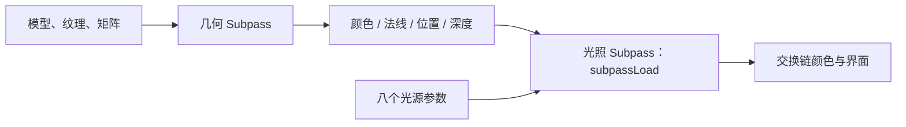

# 专题实现

[文档](README.md) · [效果展示](gallery.md) · [示例目录](samples.md) · [Vulkan 基础](vulkan-fundamentals.md)

本文沿数据流解释代码中的技术组合。通用对象和同步概念见 Vulkan 基础；各版本的独立可执行名称与源码入口集中在示例目录。

## 资源与数据输入

### 顶点、参数与模型

[顶点缓冲](../samples/01_vulkan_tutorial/02_vertex_buffers/main.cpp)把顶点和索引通过 staging 上传，再用 Vertex Input 声明解释数据。[Uniform](../samples/01_vulkan_tutorial/03_uniform_buffers/main.cpp) 将模型、观察与投影矩阵绑定到 Shader，按帧更新。

[OBJ 模型加载](../samples/01_vulkan_tutorial/06_loading_models/main.cpp)将解析后的几何转换为顶点与索引，结合纹理、矩阵和深度绘制。[glTF 模型加载](../samples/01_vulkan_tutorial/06_loading_models/main2.cpp)使用独立 target `01_06_loading_models2`；不同格式的文件资源、顶点布局和 Shader 需要匹配。

### glTF 材质预览与动画

[`01_06_loading_models2`](../samples/01_vulkan_tutorial/06_loading_models/main2.cpp) 将全部节点保存在 Model 中，场景和子节点通过索引引用；Primitive 引用共享材质。模型级 `DisplaySettings` 保存颜色来源、光照模式、显示面和参数覆盖，原始材质数据保留在 `Material::original` 中。界面修改 CPU 状态，绘制前等待当前帧 fence，再将生效参数上传到该帧的 Uniform。

[viewer.vert](../samples/01_vulkan_tutorial/06_loading_models/shaders/viewer.vert) 使用统一顶点布局处理位置、法线、两组 UV、顶点色、蒙皮和 Morph。切换 PBR、Studio 或无光照模式共用变形结果；动画暂停时保留当前姿态，默认 Morph 权重和蒙皮仍参与静止画面的绘制。缺少法线的网格在加载时生成法线。

[viewer.frag](../samples/01_vulkan_tutorial/06_loading_models/shaders/viewer.frag) 根据显示参数选择颜色与光照：

- `Material` 组合基础色因子、基础色纹理与顶点色；`Texture`、`Single` 和 `Vertex` 提供独立的颜色来源。
- PBR 使用 GGX、Schlick Fresnel 与 Smith 几何项。金属度/粗糙度贴图的 G 通道乘入粗糙度，B 通道乘入金属度；启用某个常量覆盖后，该通道改用模型级数值。
- 法线贴图通过位置与 UV 的导数构造切线空间；AO 作用于近似环境项，自发光在 PBR 输出中累加。粗糙度下限和分母保护用于避免极端参数产生无效数值。
- 基础色和自发光图片使用 sRGB 格式，金属度/粗糙度、法线与 AO 使用线性格式。同一图片按颜色空间分别缓存，避免颜色数据与参数数据混用。
- 默认双面显示，用户也可选择原材质规则或单面显示。`MASK` 材质按阈值丢弃片段；`BLEND` 材质在不透明物体之后按 Primitive 中心深度从远到近绘制，并关闭深度写入。

交换链优先使用 sRGB 格式，片段着色器输出线性颜色，由附件编码；UNORM 回退路径显式编码输出。ImGui 顶点颜色在使用 sRGB 附件时先转换到线性空间，避免界面重复编码。

当前实现使用 Studio 灯光和近似环境项，尚无 HDRI/IBL 与阴影；支持三角形、三角带和三角扇输入、`TEXCOORD_0` / `TEXCOORD_1`，每个 Primitive 最多两个 Morph 目标。透明排序按 Primitive 中心估算，相交或自遮挡的透明表面仍可能出现排序误差。画面与操作见 [glTF 模型查看器](gallery.md#gltf-模型查看器)。

### 参数的三种生命周期

| 方式 | 数据进入执行流程的时机 | 对应实现 |
| --- | --- | --- |
| Dynamic Uniform | Buffer 保存参数，绑定描述符时提供动态偏移 | [动态 Uniform](../samples/02_advance/02_dynamic_uniform_buffers/main.cpp) |
| Push Constants | 录制命令时通过 `vkCmdPushConstants` 写入 | [Push Constants](../samples/02_advance/04_pushconstants/main.cpp) |
| Specialization Constants | 创建管线时通过 `VkSpecializationInfo` 设置 | [特化常量](../samples/02_advance/05_specialization_constants/main.cpp) |

动态 Uniform 按设备对齐限制组织步长；Push Constants 需满足声明范围、设备容量以及 C++ / GLSL 偏移；特化常量为不同管线固定 Shader 参数。

### 顶点布局与实例化

[顶点属性示例](../samples/02_advance/11_vertex_attributes/main.cpp)提供交错与分离布局：

```text
交错：Buffer0 = [position, color] [position, color] ...
分离：Buffer0 = [position] [position] ...
      Buffer1 = [color]    [color]    ...
```

相应的 binding、stride 和 attribute offset 决定 Shader 如何读取。[实例化](../samples/02_advance/18_instancing/main.cpp)通过实例输入和 `gl_InstanceIndex` 为同一几何提供多组数据，重点在顶点级与实例级步进的区别。

### 纹理、Mipmap 与 Cubemap

[纹理映射](../samples/01_vulkan_tutorial/04_texture_mapping/main.cpp)串联像素上传、Image View、Sampler 和描述符。[Mipmap](../samples/01_vulkan_tutorial/07_generating_mipmaps/main.cpp)通过逐级 Blit 和布局转换生成多级图像；[MSAA](../samples/01_vulkan_tutorial/08_multi_sampling/main.cpp)使用多重采样附件并 Resolve。两者分别处理纹理缩小采样和几何边缘覆盖。

[Cubemap](../samples/02_advance/23_texture_cube_map/main.cpp)将六张图像上传到立方体兼容 Image 的六个数组层，创建 Cube View。[顶点 Shader](../samples/02_advance/23_texture_cube_map/shaders/cube.vert)传出立方体位置作为采样方向，[片段 Shader](../samples/02_advance/23_texture_cube_map/shaders/cube.frag)用 `samplerCube` 取色。六面的顺序和方向决定面与面之间的对应关系，画面见[预览](gallery.md#cubemap)。

## VMA 内存分配

内存分配分组使用 Vulkan Memory Allocator（VMA）3.3.0，通过 `ThirdParty::vma` 链接统一编译的静态库实现。两个示例包含 `<vk_mem_alloc.h>`，分别管理自身的 allocator 与资源。`CreateAllocator()` 在逻辑设备创建后初始化 `VmaAllocator`，传入 instance、physical device、device，并将运行时 Vulkan API 版本设置为 1.0。

### 资源与分配策略

`BufferDesc` 描述大小、用途、内存偏好和分配标志；`AllocatedBuffer` 同时保存 `VkBuffer` 与 `VmaAllocation`。[模型示例](../samples/09_memory_allocation/02_vma_loading_models/main.cpp)使用 `ImageDesc` / `AllocatedImage` 表达图像参数和分配结果。`vmaCreateBuffer()`、`vmaCreateImage()` 完成资源创建、内存分配及绑定。

| 资源 | 分配设置 | 数据路径 |
| --- | --- | --- |
| Staging Buffer | `AUTO_PREFER_HOST` 与 `HOST_ACCESS_SEQUENTIAL_WRITE_BIT` | `vmaCopyMemoryToAllocation()` 完成主机写入及必要的 flush，再提交传输 |
| 顶点与索引 Buffer | `AUTO_PREFER_DEVICE`，用途包含 `TRANSFER_DST` | 从 staging buffer 复制 |
| 模型 UBO | `AUTO_PREFER_HOST`、`HOST_ACCESS_SEQUENTIAL_WRITE_BIT` 与 `MAPPED_BIT` | 通过 `VmaAllocationInfo::pMappedData` 持久映射，按帧更新矩阵 |
| 纹理与深度 Image | `AUTO_PREFER_DEVICE` | 纹理经 staging 上传并转换布局；深度图像作为附件使用 |

[`09_01_vma_vertex_buffers`](../samples/09_memory_allocation/01_vma_vertex_buffers/main.cpp)上传固定的顶点与索引并绘制四边形；`09_02_vma_loading_models` 加载 Viking Room 的 OBJ 与 PNG，另外管理纹理、深度图像和 UBO。资源创建函数返回的结构体保存句柄，由程序显式管理释放。

### 主机写入与缓存可见性

主机访问标志用于申请可映射内存，`AUTO_PREFER_HOST` 表达内存选择偏好，不保证内存具有 `HOST_COHERENT` 属性。映射与持久映射提供 CPU 指针，不能替代缓存刷新或 GPU 执行同步。

两个示例通过 `vmaCopyMemoryToAllocation()` 写入顶点、索引及纹理 staging buffer，由 VMA 处理临时映射、复制和必要的缓存刷新。模型示例的 UBO 保持持久映射，每次 `memcpy` 后调用 `vmaFlushAllocation()`，刷新成功后才提交绘制。两条路径均检查 VMA 返回值，兼容 coherent 与非 coherent 内存。

`vmaFlushAllocation()` 的偏移相对于 allocation，库负责 `nonCoherentAtomSize` 对齐；对 coherent 内存，该调用无需执行底层刷新。映射、解映射与缓存操作的语义见[VMA 官方文档](https://gpuopen-librariesandsdks.github.io/VulkanMemoryAllocator/html/memory_mapping.html)。

### 资源生命周期与同步

上传函数在复制命令提交后调用 `vkQueueWaitIdle()`，随后释放 staging buffer。正常退出时，程序等待设备空闲，通过 `vmaDestroyBuffer()` / `vmaDestroyImage()` 释放资源及其 allocation，最后销毁 allocator 和 device。由 `MAPPED_BIT` 建立的持久映射随 allocation 释放，不需要额外调用 `vmaUnmapMemory()`；显式调用 `vmaMapMemory()` 获得的映射则与 `vmaUnmapMemory()` 成对使用。

两个示例按帧槽位分配指令缓冲、图像获取信号量和提交栅栏，模型示例的 UBO 与描述符也按帧槽位管理。CPU 等待当前槽位的栅栏后，更新数据并重置、录制该槽位的指令缓冲。获取的交换链图像索引用于选择 framebuffer 和呈现完成信号量。

呈现完成信号量随交换链图像分配，在交换链重建时等待设备空闲，销毁并按新图像数量重新创建。模型示例共用的深度附件通过覆盖 early / late fragment tests 的外部依赖同步跨帧读写；清理时先销毁 framebuffer，再释放深度图像视图和 VMA 图像分配。

VMA 负责内存分配与绑定。命令缓冲复用、资源访问依赖、Image 布局转换和交换链重建由应用代码管理。分配设置与接口定义见[随附头文件](../third_party/vma/vk_mem_alloc.h)，构建接入与实现归属见[第三方依赖](../third_party/README.md#单头文件库与实现归属)。

## 附件与多阶段渲染

### 管线、深度、模板与混合

[多个几何体](../samples/02_advance/01_triangles/main.cpp)通过多次绘制使用不同资源；[多管线](../samples/02_advance/03_pipelines/main.cpp)示例组织不同拓扑、填充和视口配置。

[深度缓冲](../samples/01_vulkan_tutorial/05_depth_buffering/main.cpp)把图像附件与管线的比较、写入设置组合起来。[模板示例](../samples/02_advance/13_stencil/main.cpp)先用小矩形标记模板，再绘制大矩形，通过模板比较留下边框。[混合示例](../samples/02_advance/15_blend/main.cpp)配置颜色混合因子与逻辑操作，展示输出合成状态。

### Input Attachments 与延迟渲染

[Input Attachments](../samples/02_advance/06_input_attachments/main.cpp)在后续 Subpass 读取附件。[延迟渲染](../samples/02_advance/08_deferred_shading/main.cpp)将这一机制用于 G-buffer：



[base.frag](../samples/02_advance/08_deferred_shading/shaders/base.frag)输出几何信息，[quad.frag](../samples/02_advance/08_deferred_shading/shaders/quad.frag)读取附件并计算环境项、漫反射、高光和距离衰减。Push Constant 选择直接显示颜色、法线、深度，或显示光照合成。

Subpass Dependency 连接附件写入与后续读取；ImGui backend 的 Subpass 配置与界面命令所在位置对应。界面基础接入见 [ImGui 示例](../samples/02_advance/07_imgui/main.cpp)，附件画面见[延迟渲染预览](gallery.md#延迟渲染)。

### 离屏渲染与后处理

[离屏示例](../samples/02_advance/09_offscreen/main.cpp)把颜色附件作为后续绘制的采样纹理。[后处理](../samples/02_advance/10_post_process/main.cpp)沿用两阶段结构：

```text
场景 → 离屏颜色附件 → 采样描述符 → 全屏绘制 → 交换链
```

[quad.frag](../samples/02_advance/10_post_process/shaders/quad.frag)提供反相、加权灰度、锐化、模糊、边缘检测与 FXAA。卷积函数使用固定采样偏移，FXAA 使用传入的 texel 尺寸。离屏图像同时声明附件与采样用途，写入和读取之间建立布局及内存依赖。[画面对比](gallery.md#后处理)展示各模式输出。

### 回读与多 Pass

[Blit](../samples/02_advance/12_blit/main.cpp)将交换链图像传输到可回读资源并导出 JPG；它依赖相应的 Surface usage 支持、传输用途、布局和主机读取同步。

[Render Pass](../samples/02_advance/21_render_pass/main.cpp)展示两个相同 Render Pass 的连续绘制及最终保留的结果。[深度清除版本](../samples/02_advance/21_render_pass/main2.cpp)使用 `vkCmdClearAttachments` 清除深度，改变后续绘制的遮挡关系，对应独立 target `02_21_render_pass2`。

## 计算与间接绘制

### 粒子缓冲的生产与消费

[GPU 粒子](../samples/01_vulkan_tutorial/09_compute_shader/main.cpp)使用 8192 个粒子，本地工作组大小为 256，分派 32 个工作组：

```text
时间步 Uniform + 上一组粒子 Storage Buffer
  → Compute 更新位置和速度、处理边界反弹
  → 当前粒子 Buffer
  → Vertex Input 读取位置和颜色
  → 点精灵输出
```

计算输出 Buffer 同时具有 Storage 与 Vertex 用途。图形提交等待计算完成信号，等待阶段为 Vertex Input；图像获取与呈现采用各自的同步对象。[计算 Shader](../samples/01_vulkan_tutorial/09_compute_shader/shaders/base.comp)说明更新规则，[视频](gallery.md#gpu-粒子)展示运行画面。

[CPU 粒子](../samples/02_advance/14_cpuparticle/main.cpp)把更新步骤放在 CPU，可用于对照两种数据路径。

### Storage Image

[图像处理](../samples/03_compute_shader/01_image_processing/main.cpp)使用 16×16 本地工作组，[计算 Shader](../samples/03_compute_shader/01_image_processing/shaders/base.comp)读取输入 `image2D`，将蓝色通道置零，写入输出图像；图形阶段左右显示原图与处理结果。

| GLSL 类型 | 访问方式 |
| --- | --- |
| `image2D` | 整数坐标的图像 load / store |
| `imageBuffer` | texel buffer 的 image 接口 |
| `sampler2D` | 通过 Sampler 进行纹理采样 |

该程序分别选择图形、计算和传输队列族。修改队列选择或图像尺寸时，需要一并处理队列间访问与分派边界；当前 Shader 没有显式坐标越界判断。

### 间接参数

[间接绘制](../samples/02_advance/19_indirectdraw/main.cpp)由 `vkCmdDrawIndexedIndirect` 从 Buffer 读取绘制参数，按设备的 `multiDrawIndirect` 能力组织调用。

[计算写入间接参数](../samples/03_compute_shader/02_indirect_draw/main.cpp)把参数生产步骤放到计算 Shader：

```text
CPU / 界面参数 → Uniform → Compute → 间接参数 Buffer → DrawIndexedIndirect
```

[base.comp](../samples/03_compute_shader/02_indirect_draw/shaders/base.comp)将输入字段复制到对应 `VkDrawIndexedIndirectCommand` 的输出。这个示例的重点是计算写入到间接命令读取的数据路径，两阶段之间需要匹配消费者的同步依赖。

## 命令组织与运行观测

[命令预录制](../samples/01_vulkan_tutorial/10_build_command_buffers/main.cpp)在初始化或资源重建后录制命令，在循环中复用。复用的前提是引用对象和状态持续有效，Buffer 内容更新也遵循在途资源的复用条件。

[多线程](../samples/02_advance/17_multi_thread/main.cpp)提供多种主机组织方式：

| 源码入口 / Target | 行为 |
| --- | --- |
| [`main.cpp`](../samples/02_advance/17_multi_thread/main.cpp) / `02_17_multi_thread` | 两个线程录制 Secondary Command Buffer，Primary 通过 `vkCmdExecuteCommands` 执行 |
| [`main2.cpp`](../samples/02_advance/17_multi_thread/main2.cpp) / `02_17_multi_thread2` | 在子线程中执行 `RecordCommand` |
| [`main3.cpp`](../samples/02_advance/17_multi_thread/main3.cpp) / `02_17_multi_thread3` | 在子线程中执行 `DrawFrame`，再由其子线程执行 `RecordCommand` |
| [`main4.cpp`](../samples/02_advance/17_multi_thread/main4.cpp) / `02_17_multi_thread4` | 工作线程分别录制、提交，各步骤通过 `join()` 顺序等待 |

CPU 并行录制与 GPU 执行并行由不同机制决定。Command Pool、Queue 等对象的主机访问遵守外部同步要求，线程生命周期与提交完成分别管理。

[遮挡查询](../samples/02_advance/20_query_pool/main.cpp)与[管线统计](../samples/02_advance/20_query_pool/main2.cpp)分别对应 `02_20_query_pool` 和 `02_20_query_pool2`。[Pipeline Cache](../samples/02_advance/22_pipeline_cache/main.cpp)创建缓存、读取缓存数据并持久化，供管线创建复用；缓存数据具有设备和驱动兼容性约束。

## 设备特性与扩展

| 示例 | 实现方式 | 关键能力 |
| --- | --- | --- |
| [Geometry Shader](../samples/05_geometry_shader/01_geometry_shader/main.cpp) | 输入点扩展为三角形 | `geometryShader` |
| [Viewport Arrays](../samples/05_geometry_shader/02_viewport_arrays/main.cpp) | 几何 invocation 设置 `gl_ViewportIndex`，输出到两个 viewport | `geometryShader`、`multiViewport` |
| [Conditional Rendering](../samples/06_extensions/01_conditional_render/main.cpp) | 界面更新条件 Buffer，控制图元绘制 | `VK_EXT_conditional_rendering` 及相应 feature |
| [Multiview](../samples/06_extensions/02_multi_view/main.cpp) | 视图掩码与 `gl_ViewIndex` 输出到数组图像各层，再采样显示 | Multiview feature 和相应接口 |
| [Dynamic Rendering](../samples/06_extensions/03_dynamic_rendering/main.cpp) | 开始渲染时直接指定附件 | `dynamicRendering` |
| [Mesh Shader](../samples/06_extensions/04_mesh_shader/main.cpp) | 每个工作组读取一个 meshlet，直接输出顶点与三角形 | `VK_EXT_mesh_shader`、`meshShader`；[运行要求](getting-started.md#运行-mesh-shader-示例) |

动态渲染的 [KHR 扩展版本](../samples/06_extensions/03_dynamic_rendering/main.cpp)对应 `06_03_dynamic_rendering`，[Vulkan 1.3 核心版本](../samples/06_extensions/03_dynamic_rendering/main2.cpp)对应 `06_03_dynamic_rendering2`。该路径通过管线 Rendering Create Info 声明附件格式，不创建传统 Render Pass / Framebuffer。

Viewport Arrays 选择视口，Multiview 选择视图及附件层。两者的分屏外观可以相近，但资源与执行机制不同。

## Mesh Shader 与 meshlet

### 模型数据

[`06_04_mesh_shader`](../samples/06_extensions/04_mesh_shader/main.cpp) 通过 tinyobjloader 读取 `apple.obj` 的位置与三角形索引，在 CPU 上居中、缩放模型，再用 meshoptimizer 的 `meshopt_buildMeshlets()` 划分 meshlet，并调用 `meshopt_optimizeMeshlet()` 优化每个 meshlet 的局部索引。

```text
apple.obj → CPU 划分与优化 meshlet → 四份只读 SSBO → Mesh Shader → Fragment Shader
```

模型数据保存在四份只读 SSBO 中，所有帧共享：

| 数据 | CPU / Shader 布局 | 用途 |
| --- | --- | --- |
| 顶点位置 | `glm::vec4` / `vec4` 数组 | 保存模型空间位置 |
| Meshlet 元数据 | 四个 `uint32_t` / 四个 `uint` | 保存顶点与三角形索引的偏移、数量 |
| Meshlet 顶点索引 | `uint32_t` / `uint` 数组 | 从 meshlet 局部顶点定位模型顶点 |
| 局部三角形索引 | `uint32_t` / `uint` 数组 | 每三个元素描述一个三角形 |

CPU 数据与 Shader 的 `std430` 布局对应。meshoptimizer 生成的字节三角形索引在上传前扩展为 `uint32_t`，Shader 通过 `uint` 读取。

### 绘制与帧同步

[base.mesh](../samples/06_extensions/04_mesh_shader/shaders/base.mesh) 使用 32 个 invocation 的工作组，每个工作组处理一个 meshlet，最多输出 64 个顶点和 128 个三角形。`SetMeshOutputsEXT()` 声明实际输出数量，随后各 invocation 分担顶点变换与三角形索引输出。顶点颜色由 meshlet 编号生成，[base.frag](../samples/06_extensions/04_mesh_shader/shaders/base.frag) 将该颜色写入画面，便于观察分块。

模型管线由 Mesh 与 Fragment 阶段组成。CPU 通过 `vkCmdDrawMeshTasksEXT()` 分派工作组，使用 Push Constant 传入起始 meshlet，并按设备的单次分派上限分批完成绘制。

两个帧槽位分别持有指令缓冲、UBO、图像获取信号量和提交栅栏。CPU 等待当前槽位的栅栏后更新 UBO、重置并录制该槽位的指令缓冲；获取的交换链图像索引用于选择 framebuffer 和呈现完成信号量。

所有 framebuffer 共用深度附件。Render Pass 的外部依赖覆盖 early / late fragment tests，通过深度写到深度读写的内存依赖约束跨帧访问及自动布局转换。交换链重建时等待设备空闲，重新创建图像视图、深度附件、framebuffer 和与图像数量匹配的呈现完成信号量；帧槽位资源独立于交换链图像数量。

构建环境、资源与设备要求见[运行指南](getting-started.md#运行-mesh-shader-示例)，分块效果见[运行画面](gallery.md#mesh-shader)。

## 阴影与 HDR

### 深度贴图与 PCF

[阴影映射](../samples/08_showcases/01_shadow_mapping/main.cpp)先从光源视角绘制球体和平面到深度贴图，再从相机视角将片段变换到光源空间，采样并比较深度。

[light.frag](../samples/08_showcases/01_shadow_mapping/shaders/light.frag)提供单点比较与 3×3 邻域比较平均，通过 Push Constant 切换 PCF。深度偏移、光源矩阵、贴图尺寸和采样间距共同影响边缘。该程序使用红色与阴影因子表达遮挡关系，见[画面对比](gallery.md#阴影映射)。

### 浮点颜色与色调映射

[HDR](../samples/08_showcases/02_hdr/main.cpp)以 `VK_FORMAT_R32G32B32A32_SFLOAT` 创建离屏颜色附件，输入颜色包含大于 1 的分量。[hdr2ldr.frag](../samples/08_showcases/02_hdr/shaders/hdr2ldr.frag)对采样颜色执行：

| 模式 | 逐颜色分量的公式 |
| --- | --- |
| 手动曝光 | `1 - exp(-color * exposure)` |
| Reinhard | `color / (color + 1)` |

界面控制映射开关、类型和曝光。高亮渐变几何用于观察浮点值到显示输出的变化，见[HDR 预览](gallery.md#hdr-与色调映射)。

## Headless 与 Vulkan-Hpp

[Headless Render](../samples/04_headless/01_render/main.cpp)直接创建离屏附件，绘制并回读不同视角的 JPG；[Headless Compute](../samples/04_headless/02_compute/main.cpp)上传数值、执行计算、回读并打印。它们不创建窗口、Surface 或交换链。

[Vulkan-Hpp 分组](samples.md#vulkan-hpp)通过 C++ API 和 RAII 管理对象。前六个程序从单帧离屏输出扩展到 Buffer、Uniform、纹理和深度；后两个程序引入交换链与离屏结果的窗口呈现。

RAII 绑定析构责任与 C++ 生命周期；对象之间的依赖顺序、GPU 完成条件、布局转换和帧间同步仍由程序安排。
